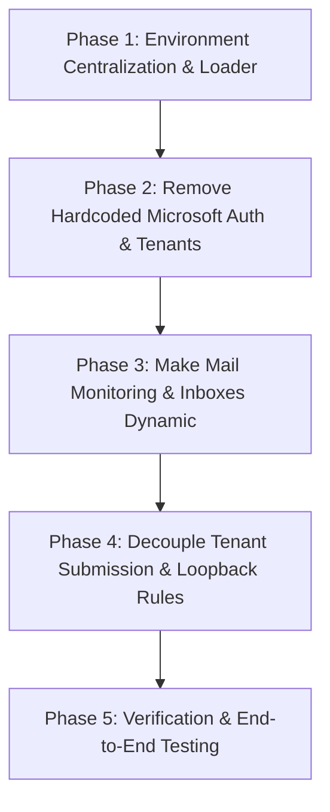

# Architectural Plan: Dynamic Configuration for Microsoft Mail Monitor & Tenant Automation

## 1. Executive Summary

The current codebase contains several hardcoded fallbacks, fixed emails, hardcoded Azure AD Tenant IDs, and path discrepancies that prevent the system from operating as a purely configuration-driven multi-tenant platform.

This plan details the step-by-step approach to eliminate all hardcoded credentials and logic, centralize environment variables, and make the Microsoft mail monitoring and tenant submission flows **100% dynamic**.

---

## 2. Problem Matrix & Target State

| Category | Current State (Hardcoded / Fragile) | Target Dynamic State |
| :--- | :--- | :--- |
| **`.env` Loading** | Lookups fail because `.env` only exists in `Gpu_server/`. `start_flow.py` and `app.py` check workspace root where `.env` is missing. | Multi-tier fallback loader: workspace root -> `Gpu_server/.env` -> OS environment. Root `.env` maintained. |
| **Microsoft Tenant ID** | Duplicate key in `.env` sets `MICROSOFT_TENANT_ID=common`, which breaks App-only flow and forces hardcoded GUID fallback (`4858c3ed-...`). | Separate `MICROSOFT_TENANT_ID` (GUID for App-Only/Client Credentials) from `MICROSOFT_AUTHORITY` / `MICROSOFT_DELEGATED_TENANT` (`common` for interactive). No hardcoded GUIDs in code. |
| **Mail Monitor Senders** | Hardcoded emails: `"drivesupport@cognethro.com"`, `"system@cognethro.com"`. | Resolved via `SENDER_EMAIL` or `DELEGATED_SENDER_EMAIL` in `.env`. |
| **Tenant Inbox Resolution** | Partially dynamic (`{TENANT}_MONITOR_EMAIL`), but has hardcoded tenant fallbacks (`"client_a"`, `"[WCUW]"` loopback filter). | Loopback filter dynamically checks `[f"[{tenant.upper()}]"]` and prefixes loaded from `submission.json`. Default tenant is set by CLI or `DEFAULT_TENANT` env var. |
| **SharePoint Automation** | Hardcoded Client ID (`430f21c4...`) and fixed folder paths (`Clients/Active/PEO Velocity/...`). | All loaded from `.env` (`SHAREPOINT_CLIENT_ID`, `SHAREPOINT_INPUT_FOLDER`, `SHAREPOINT_OUTPUT_FOLDER`). |
| **Debug & Test Scripts** | Hardcoded developer emails and local machine file paths (`c:\Users\Intern\...`). | All use `Path(__file__).parent.resolve()` and `os.getenv("MONITOR_EMAIL")` or CLI arguments. |

---

## 3. Implementation Phases



### Phase 1: Environment Centralization & Resilient Loader

1. **Fix `.env` Hierarchy & Duplication**:
   - Copy or sync `Gpu_server/.env` to `Sales team - Copy/.env` (workspace root).
   - In `.env`, resolve the duplicate key:
     ```env
     # Microsoft Azure AD Tenant ID (GUID used for Client Credentials & Org APIs)
     MICROSOFT_TENANT_ID=4858c3ed-d305-48b4-80e0-0bcdbf8ff3ae

     # Authority type for delegated browser / device-code logins (common, consumers, or specific GUID)
     MICROSOFT_LOGIN_AUTHORITY=common
     ```
2. **Implement Resilient Dotenv Loader Utility**:
   - Create a shared loader function or update scripts (`start_flow.py`, `app.py`, `partner_mail_flow.py`) to search multiple potential paths:
     ```python
     def load_workspace_env():
         for candidate in [
             WORKSPACE_DIR / ".env",
             WORKSPACE_DIR / "Gpu_server" / ".env",
             WORKSPACE_DIR / "file-classification-" / ".env",
         ]:
             if candidate.is_file():
                 load_dotenv(candidate, override=False)
     ```

---

### Phase 2: Decouple Microsoft Authentication & Tenant Identifiers

1. **`start_flow.py`**:
   - **Line 138**: Replace hardcoded `"https://login.microsoftonline.com/common"` with:
     ```python
     authority_tenant = os.getenv("MICROSOFT_LOGIN_AUTHORITY") or os.getenv("MICROSOFT_TENANT_ID") or "common"
     authority = f"https://login.microsoftonline.com/{authority_tenant}"
     ```
   - **Line 309**: Remove hardcoded `"4858c3ed-d305-48b4-80e0-0bcdbf8ff3ae"` fallback. Ensure it cleanly pulls:
     ```python
     app_tenant = self.azure_tenant_id if getattr(self, "azure_tenant_id", None) and self.azure_tenant_id != "common" else (os.getenv("SYSTEM_MAIL_TENANT_ID") or os.getenv("MICROSOFT_TENANT_ID") or os.getenv("AZURE_TENANT_ID"))
     if not app_tenant:
         raise ValueError("Missing MICROSOFT_TENANT_ID in .env required for Client Credentials token acquisition.")
     ```
   - **Lines 139–146**: Allow custom scopes via `os.getenv("MICROSOFT_SCOPES")` if specified.

2. **`email_service.py`**:
   - Replace hardcoded `_DEFAULT_DELEGATED_SENDER = "drivesupport@cognethro.com"` with:
     ```python
     _DEFAULT_DELEGATED_SENDER = os.getenv("DELEGATED_SENDER_EMAIL") or os.getenv("SENDER_EMAIL") or ""
     ```
   - Remove hardcoded UUID fallback on lines 40–42 and 91:
     ```python
     tenant_id = os.getenv("SYSTEM_MAIL_TENANT_ID") or os.getenv("AZURE_TENANT_ID") or os.getenv("MICROSOFT_TENANT_ID")
     ```

3. **`SharePoint_Agent/sharepoint_agent_module.py`**:
   - Remove hardcoded Client ID (`430f21c4...`) and Tenant ID (`4858c3ed...`).
   - Read directly from `os.getenv("MICROSOFT_CLIENT_ID")` and `os.getenv("MICROSOFT_TENANT_ID")`.
   - Make default input/output folders configurable via `SHAREPOINT_INPUT_FOLDER` and `SHAREPOINT_OUTPUT_FOLDER`.

4. **`file-classification-/onedrive_oauth.py`**:
   - Replace hardcoded UUID defaults on lines 137, 188, and 269 with `_read_env_key("MICROSOFT_TENANT_ID", "")`.

---

### Phase 3: Dynamic Mail Monitoring & Inbox Routing

1. **Dynamic Inbox Resolution**:
   - In `partner_mail_flow.py`:
     - Dynamically look up inbox addresses based on tenant code:
       ```python
       clean_tenant = self.tenant_folder.upper().replace(" ", "_")
       resolved_email = (
           user_email
           or os.getenv(f"{clean_tenant}_MONITOR_EMAIL")
           or os.getenv("PARTNER_POC_MONITOR_EMAIL")
           or os.getenv("SENDER_EMAIL")
           or None
       )
       ```
     - Remove hardcoded fallback email `"drivesupport@cognethro.com"` on line 233.
2. **Dynamic Loopback Suppression**:
   - In `partner_mail_flow.py` (line 1047):
     - Replace hardcoded `["[WCUW]", "Exception Alert", ...]` with:
       ```python
       tenant_prefix = f"[{self.tenant_folder.upper()}]"
       configured_prefixes = [tenant_prefix, "Exception Alert", "Submission Processed", "⚠️"]
       is_system_alert = any(prefix.lower() in subject.lower() for prefix in configured_prefixes)
       ```

---

### Phase 4: Dynamic Tenant Submission & Execution Hooks

1. **`start_flow.py` Stage 6**:
   - Replace fallback `"system@cognethro.com"` with `os.getenv("SYSTEM_EMAIL") or os.getenv("SENDER_EMAIL") or "no-reply@company.com"`.
2. **`partner_mail_flow.py` Initialization**:
   - Change `tenant_folder: str = "client_a"` default to pull from `os.getenv("DEFAULT_TENANT", "wcuw")`.
3. **Stand-alone Test Scripts**:
   - Update `check_inbox_live.py`, `read_live_email.py`, and `debug_graph.py` to read target email from `os.getenv("TEST_MONITOR_EMAIL") or os.getenv("WCUW_MONITOR_EMAIL")` with optional CLI argument override.
   - Remove hardcoded path `Path(r"c:\Users\Intern\...")` from `debug_graph.py`.

---

## 4. Verification & Validation Steps

1. **Config Audit**:
   - Verify that running a script without `.env` outputs informative error messages rather than silently reverting to an unconfigured CogNet mailbox.
2. **Token Flow Validation**:
   - Validate that Client Credentials acquires a Graph token using the tenant GUID from `.env`.
   - Validate that Delegated/Interactive token flow can authenticate against the configured authority.
3. **Mail Polling Verification**:
   - Run `partner_mail_flow.py --tenant wcuw --once` and confirm it queries `WCUW_MONITOR_EMAIL` from `.env`.
   - Run `partner_mail_flow.py --tenant notice_manager --once` and confirm it queries `NOTICE_MANAGER_MONITOR_EMAIL` from `.env`.
4. **End-to-End Extraction & Dispatch**:
   - Confirm processed email results dispatch either via Graph Mail-Out or Partner API with zero hardcoded parameters.
